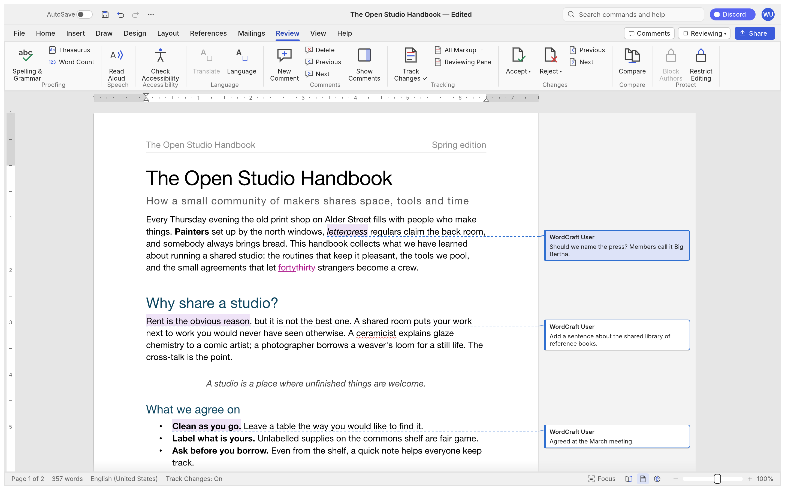
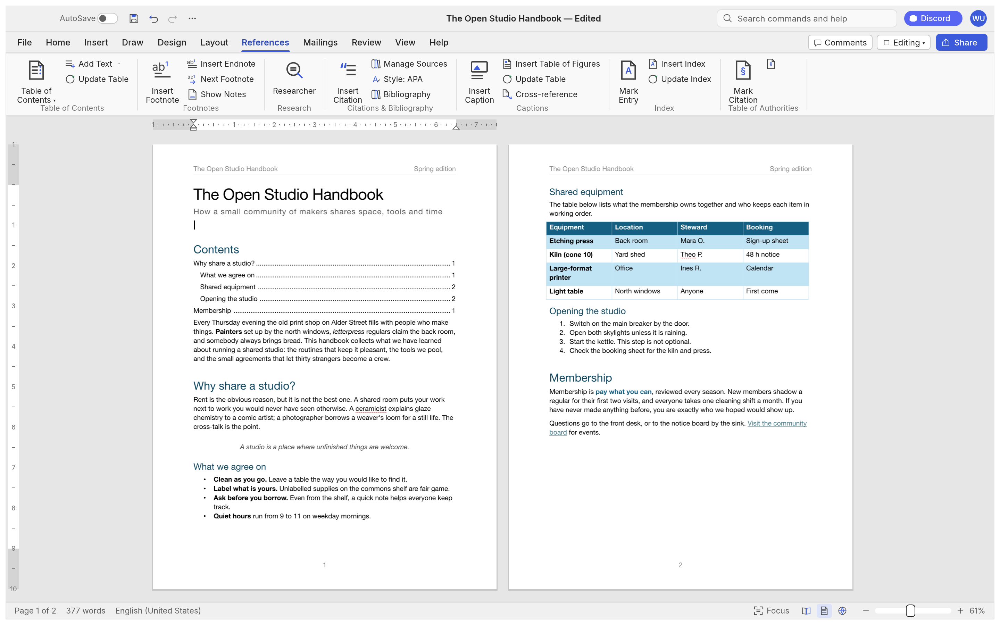
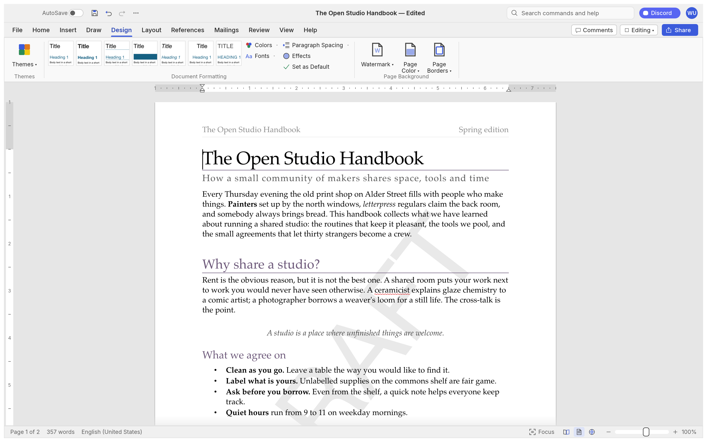
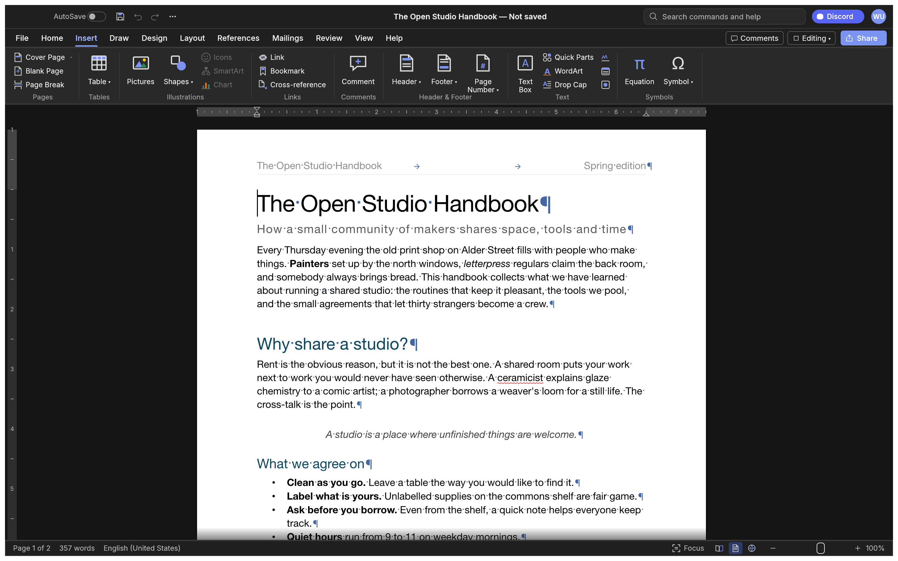

<h1 align="center">vforge-word</h1>

<p align="center">
  <b>Trình soạn thảo văn bản hiện đại, hiệu năng cao, viết thuần bằng Rust.<br>
  Tích hợp giao thức AI Agent (MCP), giao diện Ribbon chuẩn và Việt hóa toàn diện.</b>
</p>

<p align="center">
  
  
  
  
  
</p>

---

## 📖 Giới thiệu

**vforge-word** là trình soạn thảo văn bản (word processor) mã nguồn mở thế hệ mới, được tối ưu hóa cho tốc độ, độ tin cậy và khả năng tương tác với các hệ thống AI. 

Ứng dụng sở hữu luồng công việc quen thuộc của Microsoft Word (thanh Ribbon, Live Styles gallery, bảng biểu, theo dõi sửa đổi Track Changes, trích dẫn học thuật, trộn thư Mail Merge), nhưng được viết **100% bằng Rust** và render trực tiếp trên GPU thông qua `egui` + `wgpu`.

---

## ✨ Điểm nổi bật

* 🇻🇳 **Giao diện Tiếng Việt mặc định**: Toàn bộ thanh công cụ, menu, thông báo lỗi và hộp thoại đã được Việt hóa kỹ lưỡng, đồng thời hỗ trợ chuyển đổi linh hoạt giữa hơn 20 ngôn ngữ khác.
* 🚀 **Hiệu năng vượt trội (Thuần Rust)**:
  * Không dùng Electron, không dùng Tauri — giao diện vẽ trực tiếp bằng GPU, tiết kiệm RAM tối đa.
  * Thuật toán dàn trang có bộ nhớ đệm (cached layout): gõ văn bản trên tài liệu dài ~200 trang chỉ mất ~1.4 ms để tính toán lại layout.
* 📄 **Định dạng tệp đa dạng**:
  * Đọc và ghi chuẩn `.docx` (OOXML).
  * Mở tài liệu Word cũ `.doc` (Word 97-2003).
  * Xuất tệp PDF vector chất lượng cao (selectable text, link và bookmarks).
  * Nhập/xuất các định dạng: `.odt`, `.rtf`, `.html`, `.md` (Markdown), `.tex` (LaTeX), `.txt`.
* 🤖 **Sẵn sàng cho AI Agents (MCP & CLI)**:
  * Tích hợp máy chủ **Model Context Protocol (MCP)** và công cụ dòng lệnh (`wordcraft-cli`).
  * Mọi hành động (hơn 420 lệnh) đều có Command ID rõ ràng, cho phép các trợ lý AI (như Antigravity, Claude, Gemini) tự động soạn thảo, biên tập hoặc kiểm tra tài liệu.
* 🔒 **Quyền riêng tư & Hoạt động Offline**:
  * Soạn thảo, kiểm tra chính tả và ngữ pháp hoàn toàn offline trên máy tính, không gửi dữ liệu ra bên ngoài.

---

## 🖼 Giao diện ứng dụng

<table>
<tr>
<td width="50%" valign="top">
  
  <p align="center"><sub><b>Soát lại (Review).</b> Theo dõi sửa đổi (Track Changes), bóng bình luận lề phải, chấp nhận/từ chối sửa đổi.</sub></p>
</td>
<td width="50%" valign="top">
  
  <p align="center"><sub><b>Tham chiếu (References).</b> Mục lục tự động, chú thích cuối trang (Footnotes), trích dẫn chuẩn APA, MLA, Chicago, IEEE.</sub></p>
</td>
</tr>
<tr>
<td width="50%" valign="top">
  
  <p align="center"><sub><b>Thiết kế (Design).</b> Bộ chủ đề, giãn cách đoạn, hình mờ (Watermark), màu trang và viền trang.</sub></p>
</td>
<td width="50%" valign="top">
  
  <p align="center"><sub><b>Chế độ tối (Dark mode) & Chèn (Insert).</b> Bảng biểu, hình ảnh, hình vẽ khối, liên kết, đầu trang và chân trang.</sub></p>
</td>
</tr>
</table>

---

## ⚡ Hướng dẫn cài đặt & Khởi chạy

### 1. Yêu cầu hệ thống
* Cài đặt Rust và Cargo (khuyên dùng bản Rust stable hoặc nightly mới nhất).

### 2. Biên dịch và khởi chạy

```sh
# Di chuyển vào thư mục mã nguồn
cd wordcraft

# Biên dịch và mở tài liệu mẫu
cargo run --release -p wordcraft --bin vforge-word -- --sample

# Hoặc mở một tài liệu bất kỳ
cargo run --release -p wordcraft --bin vforge-word -- duong_dan_file.docx
```

Sau khi biên dịch lần đầu, bạn có thể thực thi trực tiếp tệp nhị phân siêu tốc:

```sh
./wordcraft/target/release/vforge-word --sample
```

---

## 🤖 Điều khiển bằng AI Agent & Dòng lệnh (CLI / MCP)

### Sử dụng công cụ dòng lệnh `wordcraft-cli`:

```sh
# Chuyển đổi định dạng tệp (docx, pdf, odt, rtf, html, md, tex, txt, png)
wordcraft-cli convert report.docx report.pdf

# Trích xuất văn bản thuần
wordcraft-cli text report.docx

# Xem cấu trúc tài liệu dưới dạng JSON
wordcraft-cli inspect report.docx
```

### Kết nối qua MCP Server:

```sh
# Chạy máy chủ MCP ở chế độ headless
claude mcp add vforge-word -- wordcraft-cli mcp

# Hoặc điều khiển cửa sổ ứng dụng đang mở qua socket port
./wordcraft/target/release/vforge-word --control 7981 &
claude mcp add vforge-app -- wordcraft-cli mcp --connect 127.0.0.1:7981
```

---

## 🏗 Kiến trúc dự án (Architecture)

Mã nguồn được phân tầng rõ ràng theo mô hình đa tầng:

| Tầng | Crate | Vai trò chính |
|---|---|---|
| **L0** | `wordcraft-geom` | Đơn vị đo lường, tọa độ và hình học văn bản |
| **L1** | `wordcraft-doc`, `wordcraft-fonts`, `wordcraft-proof` | Mô hình dữ liệu tài liệu (DOM), xử lý font chữ và soát lỗi chính tả / ngắt từ |
| **L2** | `wordcraft-layout`, `wordcraft-docx`, `wordcraft-formats` | Thuật toán dàn trang, phân trang, parser DOCX, ODT, RTF, HTML, Markdown |
| **L3** | `wordcraft-render`, `wordcraft-pdf` | Bộ vẽ đồ họa (vello_cpu) và xuất định dạng PDF vector |
| **L4** | `wordcraft-engine` | Quản lý phiên làm việc, Undo/Redo stack và danh mục hơn 420 commands |
| **L5** | `wordcraft-mcp` | Máy chủ Model Context Protocol (MCP) dành cho AI Agent |
| **L6** | `wordcraft-ui-egui` | Giao diện đồ họa người dùng (GUI) viết bằng egui |
| **Apps** | `wordcraft` (`vforge-word`), `wordcraft-cli`, `wordcraft-web` | Ứng dụng Desktop native, công cụ dòng lệnh (CLI) và phiên bản WebAssembly |

---

## 📜 Giấy phép mã nguồn (License)

Dự án được phát hành theo giấy phép kép:
* **[MIT License](wordcraft/LICENSE-MIT)** HOẶC **[Apache License 2.0](wordcraft/LICENSE-APACHE)** (tùy chọn của người sử dụng).
