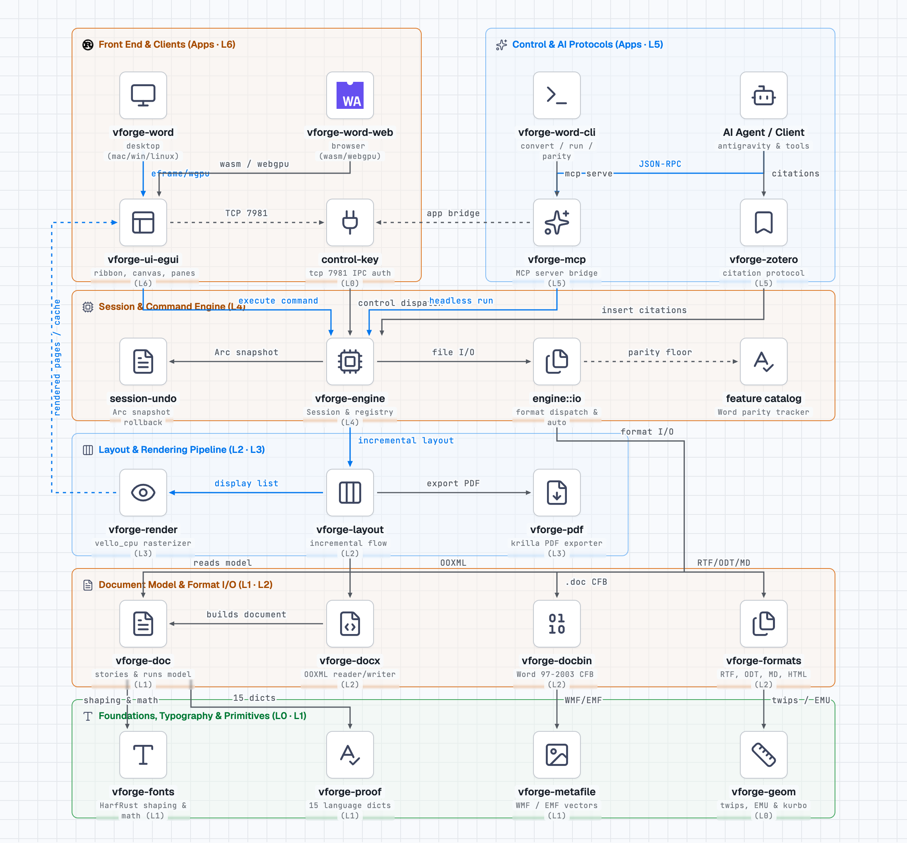
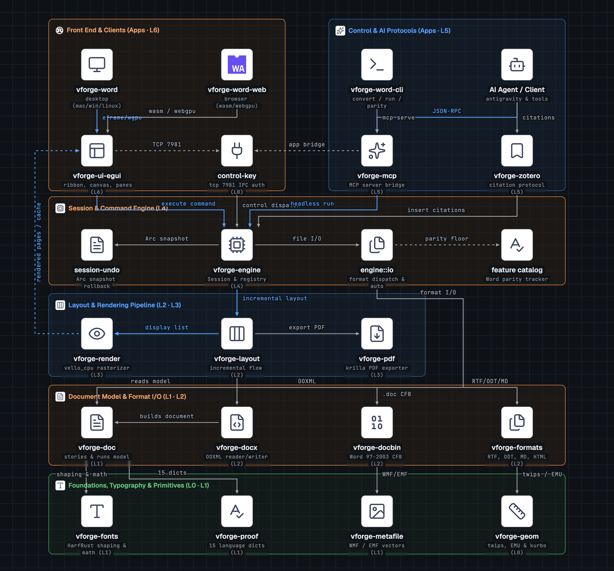

# Kiến trúc hệ thống vforge-word

Sơ đồ kiến trúc kỹ thuật của **vforge-word**, được xây dựng bằng **Skill `stack-diagram`** từ catalog **`vie-agentic-skills`** ([Vietnam Agentic Skills](https://huytran1120.github.io/vie-agentic-skills/?selected=stack-diagram)).

---

## 1. Sơ đồ kiến trúc (Stack Diagram)

### Giao diện sáng (Light Theme)

### Giao diện tối (Dark Theme)

> [!TIP]
> Bạn có thể mở trực tiếp file sơ đồ tương tác HTML độc lập (offline, đã nhúng toàn bộ font chữ và vector icon):
> 👉 **[`docs/assets/vforge-word-architecture.html`](assets/vforge-word-architecture.html)**

---

## 2. Phân tầng kiến trúc 7 lớp của vforge-word

Toàn bộ codebase của **vforge-word** (hơn 333,000 dòng mã nguồn Rust) được tổ chức theo cấu trúc phân tầng nghiêm ngặt (Strict Layering) từ L0 đến L6 và tầng ứng dụng (Apps):

| Tầng | Crate / Ứng dụng | Vai trò & Trách nhiệm chính trong vforge-word |
| :--- | :--- | :--- |
| **Apps** | [`vforge-word`](../apps/vforge-word) [`vforge-word-web`](../apps/vforge-word-web) [`vforge-word-cli`](../apps/vforge-word-cli) | • **`vforge-word`**: Ứng dụng desktop native macOS, Windows, Linux, BSD (eframe + wgpu GPU raster) • **`vforge-word-web`**: Phiên bản web WebAssembly chạy trực tiếp trên trình duyệt qua WebGPU/WebGL2 • **`vforge-word-cli`**: Công cụ CLI dòng lệnh chuyển đổi tài liệu, trích xuất text, chạy kiểm tra parity và khởi chạy MCP server |
| **L6** | [`vforge-ui-egui`](../crates/ui-egui) | Giao diện Ribbon chuẩn Microsoft Word, thanh công cụ nhanh, Backstage, thước căn lề, Canvas hiển thị trang, hỗ trợ **Việt hóa toàn diện** và kênh điều khiển IPC qua TCP port 7981 |
| **L5** | [`vforge-mcp`](../crates/mcp) [`vforge-zotero`](../crates/zotero) | • **`vforge-mcp`**: Server giao thức Model Context Protocol cho AI Agents (Google Antigravity, Claude, Gemini) điều khiển tài liệu tự động • **`vforge-zotero`**: Cầu nối giao thức trích dẫn tài liệu học thuật Zotero |
| **L4** | [`vforge-engine`](../crates/engine) | Trái tim điều phối: `Session`, Command Registry với hơn 420 Command IDs, lưu snapshot hoàn tác `Arc` (Undo/Redo tức thì), bộ bắt lỗi an toàn chống crash (`never-crash standard`) |
| **L3** | [`vforge-render`](../crates/render) [`vforge-pdf`](../crates/pdf) | • **`vforge-render`**: Rasterizer CPU tốc độ cao bằng `vello_cpu`, xuất trang ra pixel đệm cache trực tiếp lên GPU canvas • **`vforge-pdf`**: Bộ xuất PDF vector chất lượng in ấn bằng `krilla` (subset font, selectable text, outline và bookmarks) |
| **L2** | [`vforge-layout`](../crates/layout) [`vforge-docx`](../crates/docx) [`vforge-docbin`](../crates/docbin) [`vforge-formats`](../crates/formats) | • **`vforge-layout`**: Thuật toán dàn trang tăng dần (chỉ ~1.4 ms cho tài liệu 200 trang), ngắt dòng, bảng biểu, Display List • **`vforge-docx`**: Đọc/ghi OOXML WordprocessingML chuẩn (Transitional & Strict, công thức OMML) • **`vforge-docbin`**: Đọc tệp nhị phân Microsoft Word cổ `.doc` (Word 97–2003) qua container CFB • **`vforge-formats`**: Nhập/xuất các định dạng `.odt`, `.rtf`, `.html`, `.md`, `.tex`, `.txt` |
| **L1** | [`vforge-doc`](../crates/doc) [`vforge-fonts`](../crates/fonts) [`vforge-proof`](../crates/proof) [`vforge-metafile`](../crates/metafile) | • **`vforge-doc`**: Mô hình cây tài liệu gốc (Stories, Paragraphs, Runs, Styles, Revisions, Equations) • **`vforge-fonts`**: Định hình văn bản HarfRust, font database, thay thế font Word, OpenType MATH • **`vforge-proof`**: 15 từ điển kiểm tra chính tả, ngữ pháp và gạch nối từ ngữ • **`vforge-metafile`**: Bộ đọc và vẽ đồ họa vector Windows Metafile (WMF / EMF) |
| **L0** | [`vforge-geom`](../crates/geom) [`control-key`](../crates/control-key) | Đơn vị đo hình học (points, twips, EMU, cm, inch, kurbo primitives) và file khóa xác thực IPC |

---

## 3. Luồng dữ liệu và lệnh trong vforge-word

1. **Thao tác người dùng (Desktop / Web):**
   Người dùng click Ribbon hoặc soạn thảo $\rightarrow$ `vforge-ui-egui` $\rightarrow$ phát lệnh `Session::run` tại `vforge-engine` $\rightarrow$ lưu snapshot hoàn tác `Arc` $\rightarrow$ cập nhật mô hình `vforge-doc`.
2. **AI Agent tự động hóa (MCP):**
   AI Agent gửi lệnh qua JSON-RPC $\rightarrow$ `vforge-mcp` (thực thi headless trực tiếp trên `vforge-engine` hoặc bridge qua `control-key` tới cửa sổ `vforge-word` đang mở qua TCP 7981).
3. **Dàn trang & Vẽ đồ họa (Display List & Rendering):**
   `vforge-engine` gọi `vforge-layout` thực hiện dàn trang incremental $\rightarrow$ xuất Display List $\rightarrow$ `vforge-render` render CPU siêu tốc ra pixel buffer đưa lên canvas của `vforge-ui-egui`.
4. **Đọc / Ghi tệp:**
   `engine::io` tự động nhận diện định dạng tệp và điều phối qua `vforge-docx`, `vforge-docbin` hoặc `vforge-formats` để tạo cây tài liệu `vforge-doc`. Xuất bản PDF được thực hiện trực tiếp từ Display List qua `vforge-pdf`.
